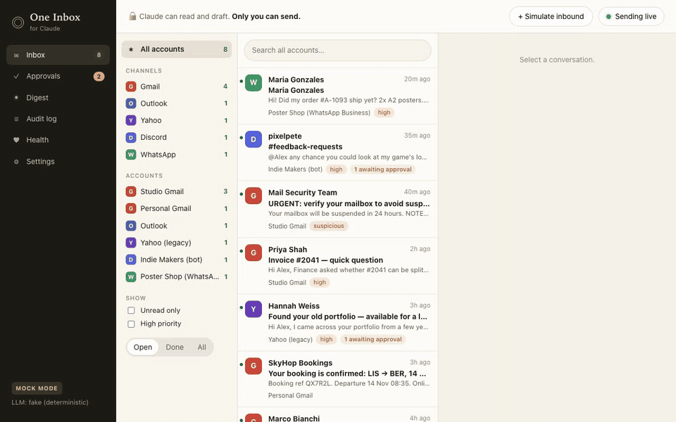
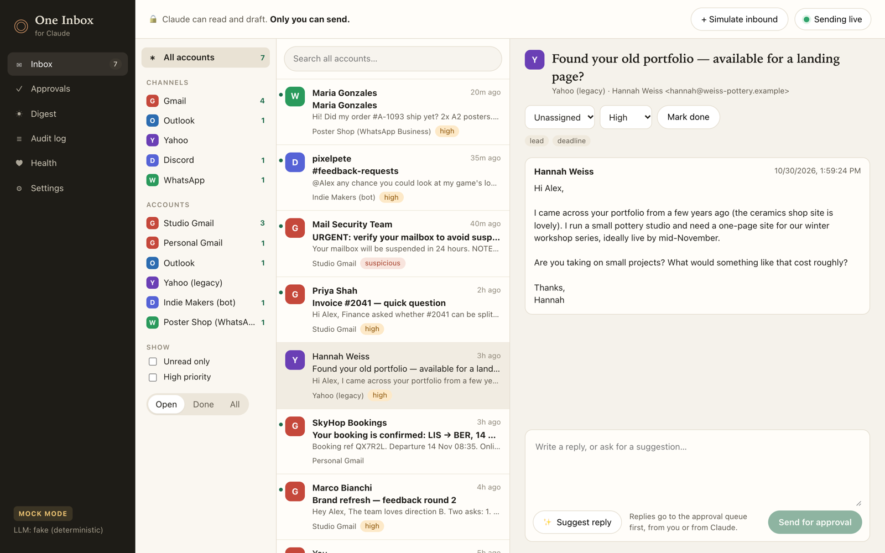
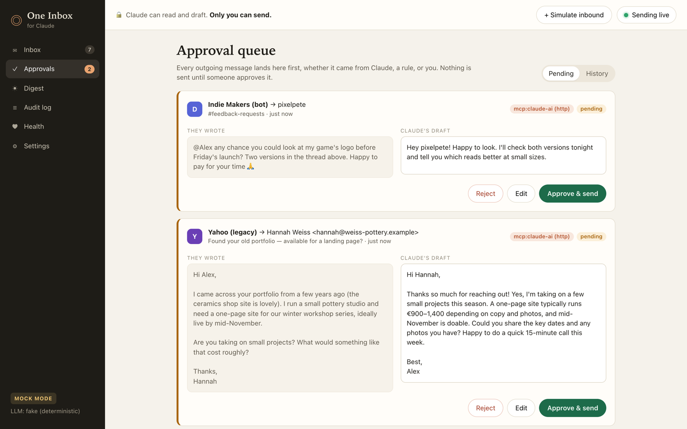
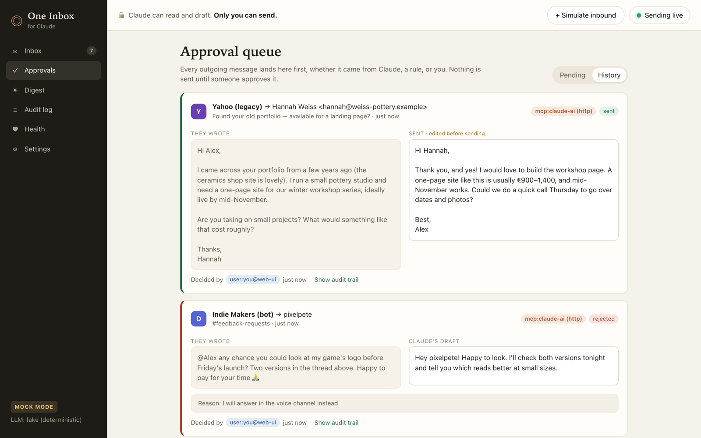
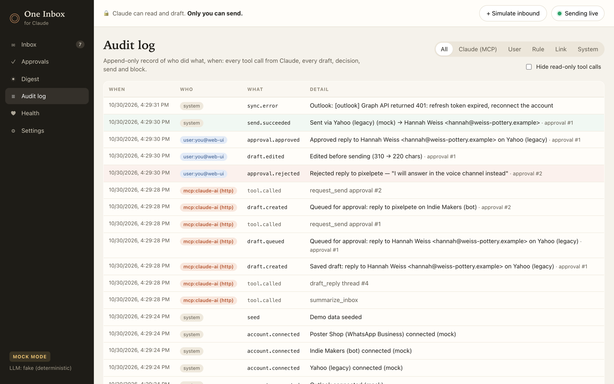
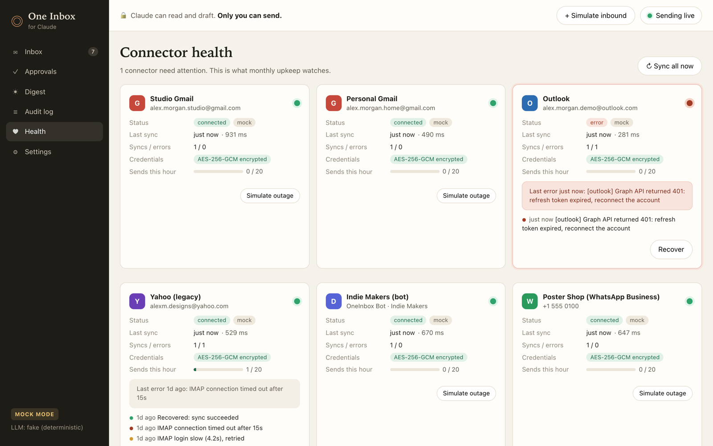
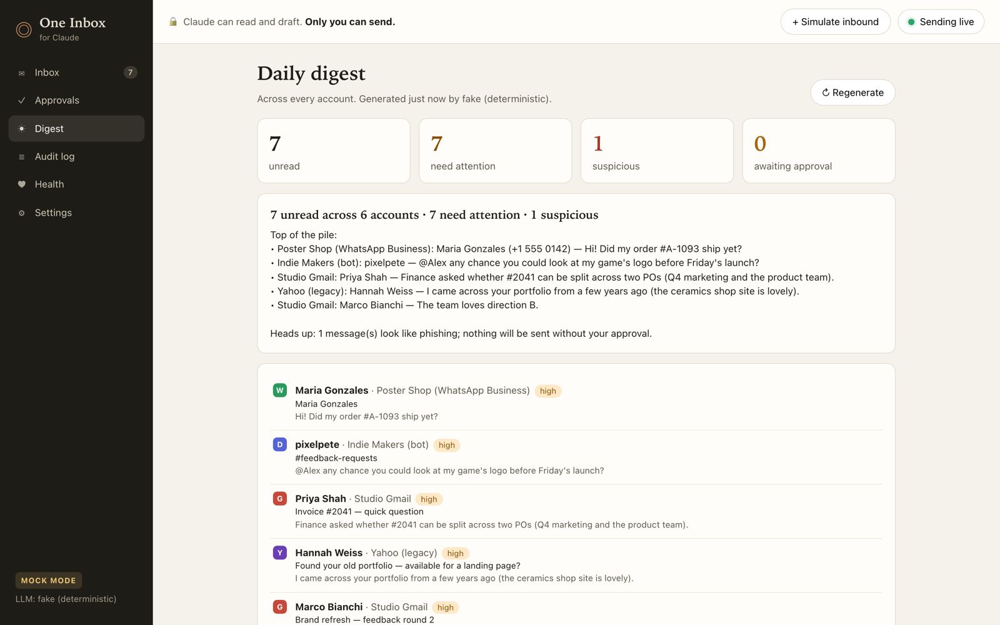
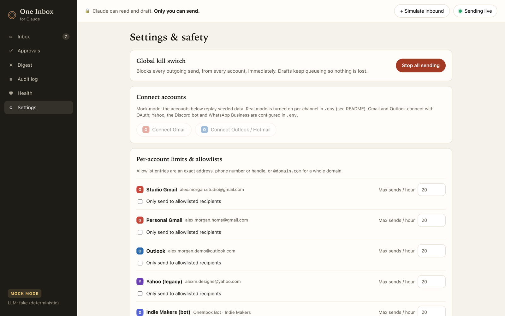
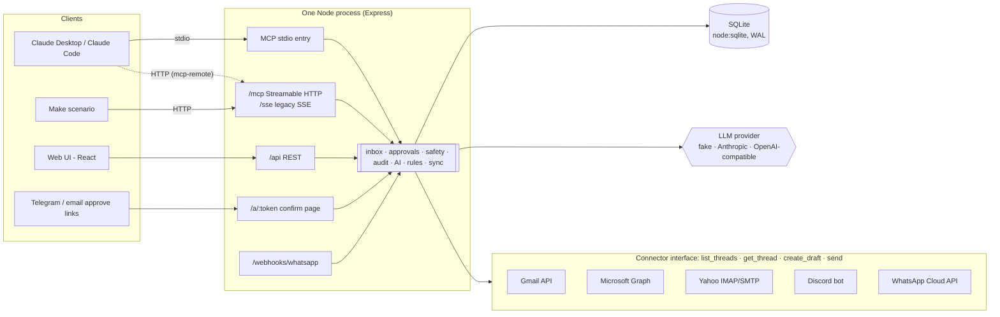
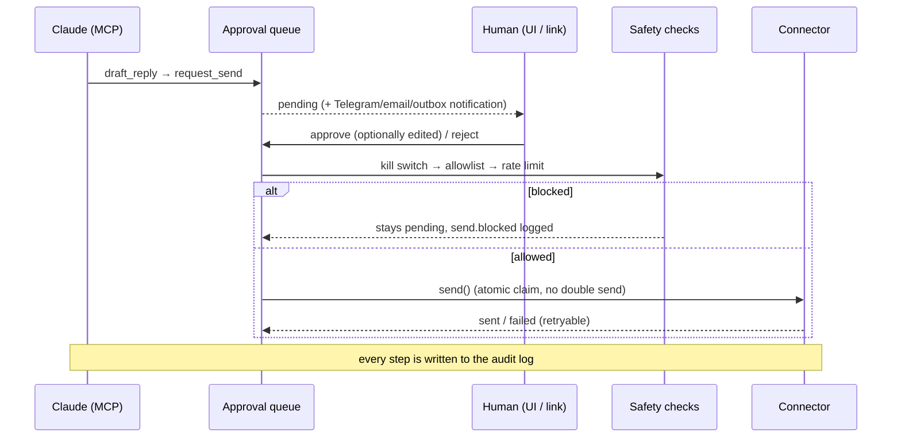

# One Inbox for Claude

A unified inbox for **Gmail, Outlook/Hotmail, Yahoo, a Discord bot and WhatsApp Business**, exposed to Claude through an MCP server, with a **human approval gate on every outgoing message**.

Claude can read, search, summarize and draft across all of your accounts. It cannot send. Every reply, whether it comes from Claude, an automation rule or you, lands in an approval queue. You approve it, edit and approve it, or reject it. Only an approval triggers the actual send, and the audit log records each step. The same server also plugs into a **Make** scenario, with the same rules.

The demo runs end to end with **zero credentials** in mock mode (seeded, realistic conversations on every channel), and switches to the real provider APIs per channel through config.

| Unified inbox | Approval queue |
|---|---|
|  |  |
| **Decisions (edited + rejected)** | **Audit log** |
|  |  |
| **Connector health** | **Daily digest** |
|  |  |
| **Settings & safety** | |
|  | |

---

## 3-minute demo script

Setup: the app running locally, the MCP server added to Claude Desktop, and the web UI open at **Approvals**.

| # | Do | What the client sees |
|---|----|----|
| 1 | In Claude Desktop: **"Summarize my unread across all accounts."** | Claude calls `summarize_inbox` and lists the unread items across 6 accounts: an invoice question, a brand-feedback deadline, a lease renewal, a Yahoo lead, a Discord feedback request and a WhatsApp order question. It also flags a **phishing email that tries to instruct the AI** and does not act on it. |
| 2 | **"Reply to the Yahoo thread from Hannah and the Discord message from pixelpete."** | Claude calls `get_thread`, `draft_reply` and `request_send` twice, and says both replies are *waiting for your approval*. Nothing has been sent. |
| 3 | Web UI → **Approvals** (badge shows 2) | Two cards, each showing the channel, account, recipient, *what they wrote* and *Claude's draft*, labelled with the MCP client's own name. |
| 4 | Yahoo card: **Edit** → change a sentence → **Approve edited & send** | The card moves to History, marked *edited before sending*, and the reply appears in the Yahoo thread in **Inbox**. |
| 5 | Discord card: **Reject** → reason "I'll answer in voice chat" | Card marked rejected. Nothing was sent. |
| 6 | **Audit log** | The full trail: Claude's tool calls (with the client's name), draft created, queued, edited, approved, sent, rejected, plus who did each and when. |
| 7 | *(optional)* Top bar **Sending live** → **Sending paused**, then try to approve another reply | Blocked by the kill switch. The item stays pending and `send.blocked` is logged. |
| 8 | *(optional)* **Health** → **Simulate outage** on Outlook | The connector goes red with a provider-style error; **Recover** turns it green and logs a recovery event. |

An end-to-end smoke test drives the same flow over MCP (Streamable HTTP and stdio): 29 checks covering the approval gate, kill switch, allowlist, edit-then-approve, reject, double-send protection, signed approve links, the CSRF guard and the audit log.

---

## Architecture

The send path. There is exactly one caller of `connector.send()` in the codebase:

- **One process, one port.** Express serves the API, the MCP endpoints, the approve-link pages, the WhatsApp webhook and the React UI.
- **SQLite via Node's built-in `node:sqlite`.** WAL mode lets the stdio MCP process (spawned by Claude Desktop) and the web process share one file, so drafts created over stdio appear live in the UI.
- **Sync model.** Connectors are the source of truth. A sync loop pulls threads into SQLite idempotently; WhatsApp is push-based through its webhook and feeds the same ingest path. Mock connectors run through the exact same code.

### MCP tools

| Tool | What it does |
|---|---|
| `list_accounts` | Connected accounts with unread counts and connector health |
| `search_messages` | Text search across all accounts (sender, subject, body), filterable by account or channel |
| `get_thread` | One conversation, oldest first, plus any drafts already waiting |
| `summarize_inbox` | Digest: headline, narrative, and threads needing attention with priority and tags |
| `draft_reply` | Saves a draft, using your text or a suggested reply. Does **not** queue or send |
| `request_send` | Puts a draft (or thread + text) in the **approval queue**. Does **not** send |

There is deliberately **no send tool**. Tool results mark message bodies as untrusted third-party content, and the server's MCP instructions tell the model the same.

---

## How Claude and Make connect

- **Claude Desktop:** stdio (Claude Desktop starts the server itself) or over HTTP through `mcp-remote`. A helper prints the ready-to-paste config.
- **Claude Code:** one `claude mcp add --transport http …` command against the running server.
- **Make:** an MCP client module pointed at the app's `/mcp` endpoint (Streamable HTTP, `/sse` for older clients), exposed through a tunnel, with a bearer token. Make gets the same six tools, so a scenario like *daily `summarize_inbox` → post to Slack* works, and anything it queues with `request_send` still waits for a human.

---

## Real mode, per channel

Each channel switches from mock to real independently, and credentials are stored AES-256-GCM-encrypted.

- **Gmail:** Google OAuth + Gmail API.
- **Outlook / Hotmail:** Microsoft OAuth + Graph.
- **Yahoo:** IMAP/SMTP with an app password.
- **Discord:** official bot token only. The app refuses user tokens, since self-bots break Discord's Terms of Service.
- **WhatsApp:** Business Cloud API on a business number, with signed webhooks and the 24-hour reply window enforced. No unofficial personal-account clients.
- **LLM (optional):** Anthropic or any OpenAI-compatible endpoint for the digest, suggested replies and priority tags, with a deterministic fallback so the UI never breaks.

---

## Safety design

- **Approval gate.** No send tool over MCP. One function sends, and it claims the row atomically first, so a double click or two approvers at once cannot send twice.
- **Recipients come from the thread, not the model.** Claude cannot be talked into redirecting a reply to another address.
- **Approve links can't be triggered by a preview.** HMAC-signed, 24h expiry, single use, and they open a confirm page; only its POST button sends.
- **Kill switch** (UI toggle plus an env hard override), **per-account rate limit**, and an optional **recipient allowlist**.
- **Prompt-injection awareness.** Message bodies are labelled untrusted, and triage flags injection-style content. The seeded phishing email is refused by the suggestion engine.
- **Local-first guards.** Binds to localhost, checks the `Host` header against DNS rebinding, requires a custom header on mutating API calls, and supports a bearer token for MCP over HTTP.
- **Full audit log** of every tool call, draft, edit, decision, send, failure, block and setting change, with who did it.

---

## What's deliberately out of scope

This is a single-user, local-first demo: no login, no attachments or HTML rendering, no WhatsApp templates, and polling sync instead of Gmail/Graph push subscriptions. Mock mode is verified end to end; the real-mode connectors follow the providers' documented APIs but have not been run against live accounts in this build, so expect small fixes on first connect.

---

## About this repo

This is a public showcase. The source code is private. I'm happy to do a live walkthrough or share access for a specific project.

Built by **Dimas Victor**: fullstack developer working on AI agents, chatbots, and automation.
[GitHub](https://github.com/dvictor357) · [LinkedIn](https://www.linkedin.com/in/dimasvic/) · [X](https://x.com/dvictor3579)
